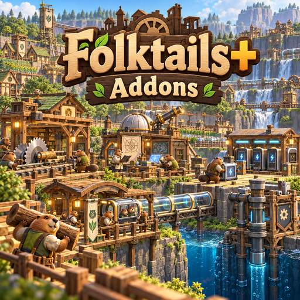

# Folktails+ Addons

**One mod. Four optional features. One settings panel.**

A compatibility-focused collection of Folktails+ enhancements for Timberborn **1.1**. It merges Charging Boost, Tiny Tubeway, Scientific Project unlocks, and **FT Mixer – Real Costs** without installing four separate mods.

- **Mod ID:** `tharbad08.FolktailsPlusAddons`
- **Author:** `tharbad08`
- **Version:** 1.1.5
- **Source:** https://github.com/tharbad08/TB-Folktails-Plus-Addons
- **Game:** Timberborn 1.1.1 or newer in the 1.1 series

## Features at a glance

| Setting (each enabled by default) | What it does | Required enabled mods |
| --- | --- | --- |
| **Charging station boost** | Adds the Charging Boost need/effect to bot charging, as in the original Folktails+ enhancement | Folktails+ |
| **Tiny Tubeway Station** | Makes Bobingabout's Tiny Tubeway Station available to Folktails via the Folktails+ building collection | Folktails+, Tiny Tubeway Station |
| **Scientific projects** | Enables five Iron Teeth scientific projects for Folktails | Folktails+, Scientific Projects, Alternative Recipes Scientific Projects |
| **FT Mixer – realistic costs** | Applies the original four Iron Teeth building prices to mixed-faction Folktails colonies | Folktails+ |

### FT Mixer – realistic costs

This feature preserves the uploaded **FT Mixer real costs** material requirements and science costs. It changes **costs only**, leaving sound, selection, placement, and other building behaviors to Timberborn and the original mods.

| Iron Teeth building | Materials | Science |
| --- | --- | ---: |
| Deep Water Pump | 24 Logs | 100 |
| Deep Badwater Pump | 40 Logs, 20 Gears, 20 Metal Parts | 500 |
| Deep Mechanical Fluid Pump | 100 Gears, 50 Treated Planks, 50 Metal Blocks | 5,000 |
| Industrial Lumber Mill | 40 Logs | 200 |

These changes apply to newly constructed buildings; they do not refund or retroactively bill already-built structures.

## Installation

1. Install and enable **Folktails+** (v11+) and its own prerequisites, **eMka Mod Settings** (1.1.1+), **TimberUi** (11.0.1+) and **Harmony** (2.4.1+).
2. Download the compiled `FolktailsPlusAddons_1.1.4` artifact from [GitHub Actions](https://github.com/tharbad08/TB-Folktails-Plus-Addons/actions/workflows/build.yml), or the direct ZIP provided in the associated chat.
3. Extract the **single** `FolktailsPlusAddons` folder into `Documents/Timberborn/Mods/` (Linux: use the equivalent Timberborn Mods directory). Confirm it contains `version-1.1/manifest.json`, `version-1.1/Scripts/FolktailsPlusAddons.dll`, `Payload/`, `README.md`, and `ModDesc.txt`.
4. **Remove legacy folders** from the previous separate addons (ChargingBoost, TinyTubeway_FolktailsPlus, Unlock Scientific, FT Mixer real costs). Do not remove the *underlying required* companion mods.
5. Launch Timberborn, enable **Folktails+ Addons**, and restart once. Open the game's mod list → this mod → **Settings** to see all four feature toggles.

**If an optional companion mod is missing or disabled, the corresponding feature is inactive; the other features continue to work.** The mixer-cost and charging features only need Folktails+.

## Settings, load order and auto detection

The runtime follows the **TB Optimizer** pattern: a custom Mod Settings panel with compact labels and 1–2 line descriptions, default-on switches, and restart-required changes. It reads enabled mod IDs from Timberborn's `ModRepository` (not merely from folders on disk). This prevents Tiny Tubeway and Scientific Projects additions from referencing missing mods.

Each feature has its own payload in `Payload/<feature>/`, stored as `.template` files **outside** Timberborn's active blueprint search tree. The DLL copies only the enabled/dependency-satisfied blueprints into its **own** `version-1.1/` folder and removes only its own inactive patches. Settings live in `folktails-addons-options.txt` next to the mod; no companion-mod assets, manifests, or DLLs are overwritten.

**Restart Timberborn after changing a checkbox or installed mods.** This mod needs write access to its own installation directory to materialize the selected blueprints. Steam Workshop folders may be read-only or automatically overwritten, so a local Mods installation is recommended.

### Dependencies

**Always required:** `FolktailsPlus`, `eMka.ModSettings`, `TimberUi`, `Harmony`. These are listed under `RequiredMods` in the manifest.

**Optional, automatically detected:** `BobingaboutTinyTubewayStation`, `ScientificProjects`, `AlternativeRecipesSPs`. These are under `OptionalMods`; none is required just to use Charging Boost or FT Mixer.

## Compatibility and cautions

- Designed for **Timberborn 1.1** and Folktails+ 11.x.
- Maintains **one manifest, one mod ID, one compiled DLL**, four independent feature toggles.
- All building and science assets come from Timberborn or other installed mods: no copies of companion-mod blueprints are bundled.
- The original FT Mixer ZIP also specified selection sounds and placement flags; this integration intentionally patches only material and science prices to reduce conflicts.
- Existing saves: make a backup before enabling or disabling features involving buildings or scientific projects.
- Compilation/JSON/archive tests verify packaging, **not** actual gameplay; check `Player.log` if a feature fails to appear. Detection relies on Mod Settings initialization before the game scans addon blueprints.

## Developer notes

| Path | Purpose |
| --- | --- |
| `Runtime/AddonRuntime.cs` | Feature dependency detection, toggle persistence, UI, and managed blueprint installation |
| `Mod/Payload/ChargingBoost/` | Charging Boost patches |
| `Mod/Payload/TinyTubeway/` | Tiny station collection patch |
| `Mod/Payload/ScientificProjects/` | Five faction-allowlist patches |
| `Mod/Payload/MixerCosts/` | Four minimal cost-only building patches |
| `Mod/manifest.json` | One shared mod ID, required/optional mod IDs |
| `Mod/ModDesc.txt` | Steam Workshop-style description |
| `.github/workflows/build.yml` | Build and package a single installable ZIP |

### Build

Push to `main` or run the [Build workflow](https://github.com/tharbad08/TB-Folktails-Plus-Addons/actions/workflows/build.yml). The workflow compiles the DLL with TB Optimizer's reference stubs, validates all 14 blueprint templates, and produces a single-folder artifact. Those stubs verify compilation **only**, not binary compatibility with a particular installed Timberborn build.

## Changelog

**1.1.5** — Fixed late feature activation with an early ModRepository hook; added per-feature Player.log status reporting.\n\n**1.1.4** — Merged FT Mixer real costs; added an independent fourth toggle; kept its four material/science cost tables; upgraded documentation and mod description.

**1.1.3** — Single-mod DLL with three optional features, dependency checks, and Mod Settings integration.

## Steam Workshop cover

The mod has **no in-game icon**. The artwork is solely for the Steam Workshop listing. Use [`WorkshopCover.png`](WorkshopCover.png) (1254 × 1254) as the full-resolution cover; [`WorkshopPreview.jpg`](WorkshopPreview.jpg) (512 × 512) is a smaller thumbnail. Both images are also included in the installable ZIP. The artwork does not change gameplay.

## 1.1.5: loading-order fix and save safety

**Fixed:** Previously, automatic feature detection waited for the Mod Settings owner to be constructed, possibly after the game had already loaded blueprints. The runtime now hooks `ModRepository.Load` and reconciles the payloads as soon as that repository finishes loading, ahead of the blueprint asset providers. It writes a per-feature status line to `Player.log` so missing dependencies and disabled checkboxes are distinguishable. Requires Harmony 2.4.1.

**Important known issue:** Some existing saves report `TubewayStation.Tiny.IronTeeth` missing even when Tiny Tubeway Station 1.1.2 is installed, and previous saves can contain obsolete `ChargingBoost` need data. Those errors predate this fix and are not conclusively repaired just by changing load order. **Do not overwrite your last known-good save until its building templates load without errors.** If still missing, supply the installed Tiny Tubeway Station mod folder and an affected save for targeted recovery.

